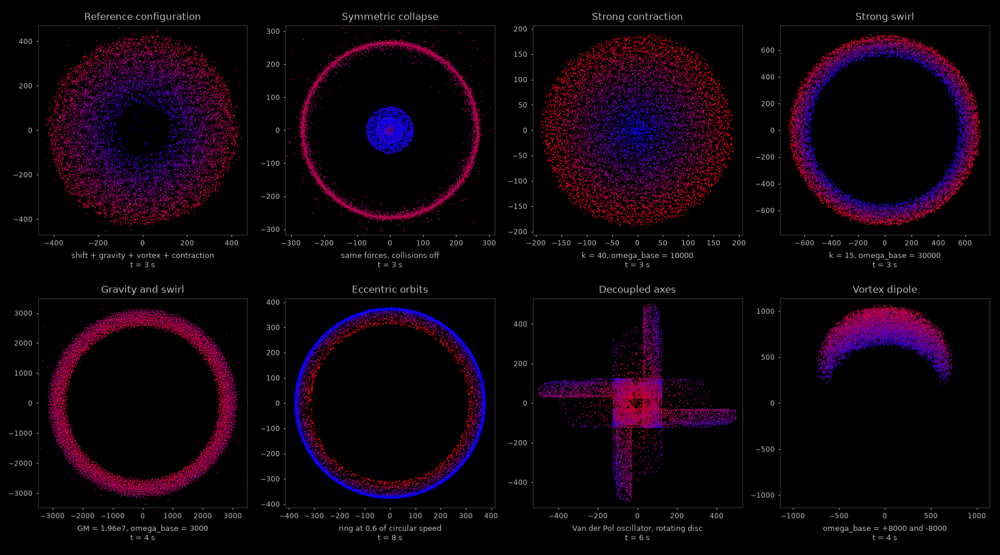

# gas: a 2D particle simulator for ODE models and force-field control

gas simulates up to ten thousand point particles in the plane. The motion of every
particle is an ordinary differential equation `dx/dt = f(x)` assembled from independent,
composable terms: central fields, swirling flows, linear state feedback, nonlinear
oscillators and pairwise contact forces. The set of terms is a compile-time choice, so a
configuration is a type and carries no run-time dispatch cost.

The project is built around the way control engineers and dynamical-systems researchers
describe a plant: a state vector, a vector field made of simple pieces, an explicit
integrator, and measurable properties of the resulting behaviour such as decay rates,
symmetry, rotation and stability limits. It has a real-time OpenGL front end and a
headless runner that produces reproducible data sets and figures.

Final states of eight scenarios, each a different composition of the same building
blocks. Colour is normalised speed, from blue (slowest) to red (fastest).

## Features

* Forces are plain callables over a state view and a derivative view, composed at
  compile time through `std::tuple`.
* Fixed-parameter forces (`include/gas_core/forces.hpp`) and parametric versions for
  parameter sweeps (`include/gas_core/forces_parametric.hpp`), checked to agree bit for
  bit.
* Explicit Euler integration with a spatial hash grid for pairwise collisions.
* A headless runner with a seeded initial condition, snapshots and time-series metrics;
  two runs produce byte-identical files.
* Checked against the closed-form solution of a linear contraction.

## Requirements

* Linux with `git`, and a conda distribution (for example Miniforge).
* For the interactive application, a display with OpenGL 3.3. It was built and run on
  Ubuntu 24.04 in a Wayland session through XWayland. Other platforms were not tried.

## Installation

All tools are installed into a dedicated conda environment, and nothing is installed
system-wide.

**1. Create the environment.** It provides CMake (3.30 or newer), Ninja, GCC 13 (the code
uses C++23), the X11 and OpenGL development packages, Python, NumPy and Matplotlib.

    conda env create -f environment.yml
    conda activate gas

**2. Fetch the third-party sources.** The renderer needs GLFW, GLM and GLAD in
`external/`. The commits pinned by the submodule entries in this repository are no longer
available upstream, so `git submodule update --init` fails. Use these releases, which are
the versions the project was built and run with:

    git clone --depth 1 --branch 3.4     https://github.com/glfw/glfw.git   external/glfw
    git clone --depth 1 --branch 1.0.1   https://github.com/g-truc/glm.git  external/glm
    git clone --depth 1 --branch v0.1.36 https://github.com/Dav1dde/glad.git external/glad
    (cd external/glad && python -m glad --profile core --api gl=3.3 --generator c --out-path .)

The last command generates the OpenGL 3.3 core loader and needs network access once. The
headless runner does not use these libraries.

**3. Build.**

    cmake -S . -B build -G Ninja -DCMAKE_BUILD_TYPE=Release \
          -DCMAKE_PREFIX_PATH=$CONDA_PREFIX -DGLFW_BUILD_WAYLAND=OFF
    cmake --build build

`-DGLFW_BUILD_WAYLAND=OFF` builds GLFW for X11 only, which also runs on a Wayland desktop
through XWayland. The build produces two executables in `build/src/`: `gas`, the
interactive application, and `gas_headless`, the window-less runner.

## Running a first example

The example is the reference configuration from `src/app.cpp`: four forces acting on a
random box of particles.

    Simulator<gas::config::N,
              decltype(second_order_shift),   // dp/dt  += v
              decltype(planetGravity_2),      // dv/dt  += inverse-square attraction
              decltype(Vortex_2),             // dv/dt  += swirl and drag
              decltype(density)>              // dp/dt  += -k p
        simulator{second_order_shift, planetGravity_2, Vortex_2, density};

**Interactive.** The application reads its shaders with a relative path, so start it from
`build/`. Escape closes the window.

    conda activate gas
    cd build
    ./src/gas

**Headless, with a figure.** Run the same configuration for 3 s of model time without a
window, then render the saved snapshots:

    cd build
    ./src/gas_headless --only app_baseline --out runs
    cd ..
    python tools/render_gallery.py --runs build/runs

The figure is written to `build/runs/pictures/app_baseline.png`. It shows the box
contracting to a disc and relaxing into a rotating annulus. To run every scenario and
regenerate the figure at the top of this page, omit `--only`:

    cd build && ./src/gas_headless --out runs && cd ..
    python tools/render_gallery.py --runs build/runs --docs docs/images

## Documentation

[doc.md](doc.md) covers the model and integrator, the catalogue of forces, the
headless runner and its output files, the example scenarios with the code that produced
them, parameter sweeps, the validation against the analytical solution, the project
layout and the known limitations.

## Status
who knows, there is a possibility of updates soon [nov 26]

## Disclaimer

The documentation in this repository (this README, doc.md and the figures in
`docs/images`) was generated with the assistance of Claude, an AI model by Anthropic.
The source code was written by the repository author.
