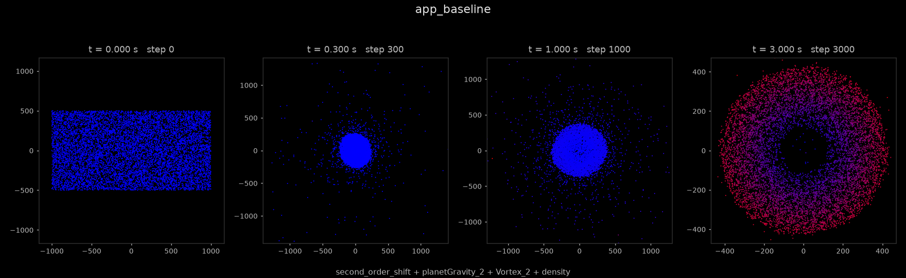
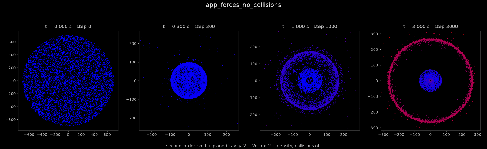
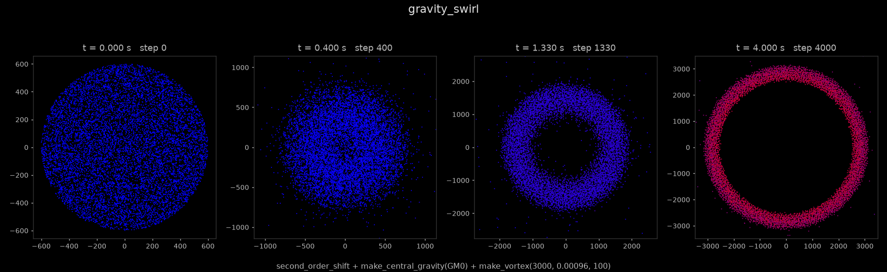
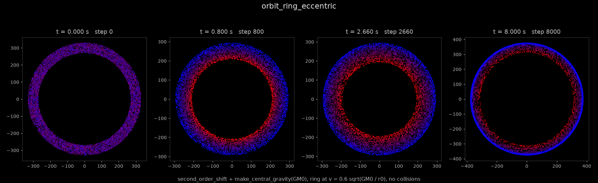
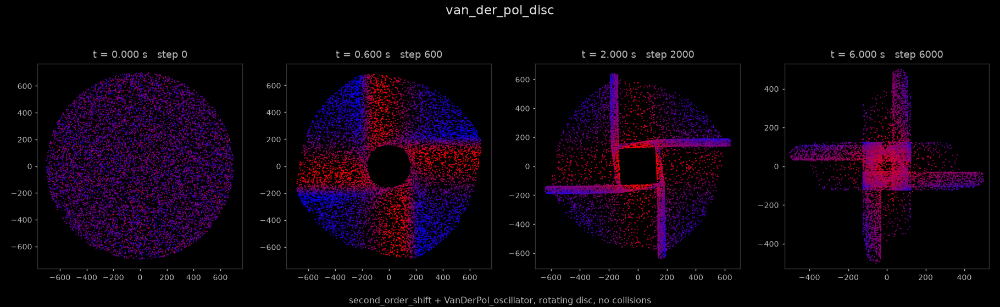
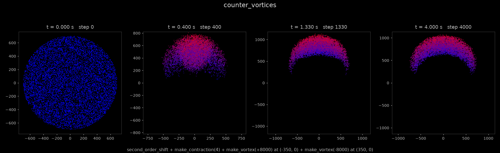
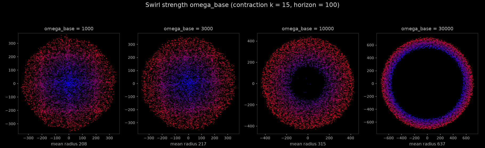
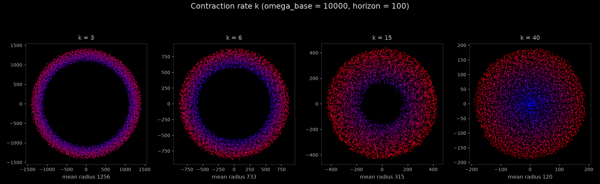
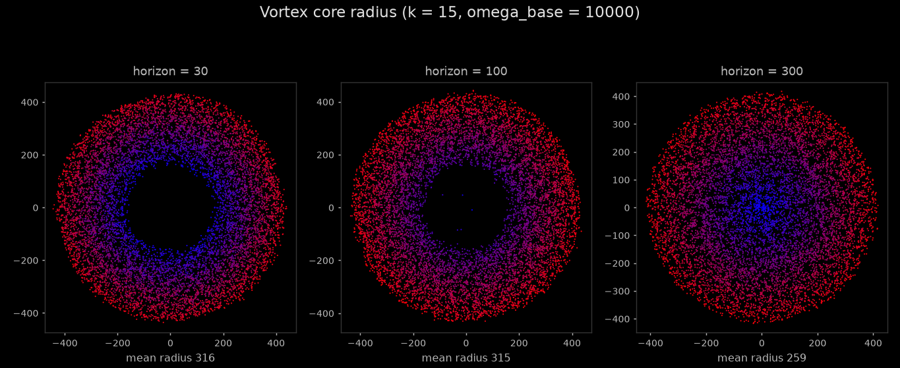
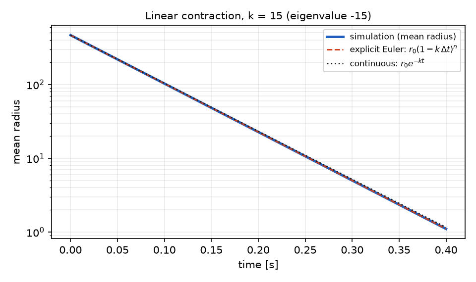

# gas: technical documentation

This document describes the model, the available forces, the headless runner, the
example scenarios and the known limitations of gas. For what the project is, how to
install it and how to run a first example, see [README.md](README.md).

## Table of contents

1. [Model](#model)
2. [Force catalogue](#force-catalogue)
3. [Interactive application](#interactive-application)
4. [Headless runner and outputs](#headless-runner-and-outputs)
5. [Examples](#examples)
6. [Parameter sweeps](#parameter-sweeps)
7. [Validation against an analytical solution](#validation-against-an-analytical-solution)
8. [All scenarios](#all-scenarios)
9. [Project layout](#project-layout)
10. [Known limitations](#known-limitations)

## Model

Each particle has the state

    x = [ px, py, vx, vy ]

and the simulator integrates

    dx/dt = f(x) = sum over forces F_i of F_i(x)

with the explicit Euler method and a fixed step dt = 0.001 (see `Simulator::evolve`
in `src/gas_core/simulator.cpp`):

    x[n+1] = x[n] + dt * f(x[n])

A force is any callable that receives two views and accumulates into the second one:

    auto my_force = [](auto& s, auto& d) {
        d.accX() += ...;   // contribution to d(vx)/dt
        d.velX() += ...;   // contribution to d(px)/dt
    };

* `s` is a read view of the particle state (`posX()`, `posY()`, `velX()`, `velY()`).
* `d` is a write view of the derivative (`velX()`, `velY()` are the derivatives of the
  position, `accX()`, `accY()` are the derivatives of the velocity).
* The views are parameterised by a layout (`include/layout`). The layout in use is
  selected in `include/config.hpp`; a second-order layout (position and velocity) is
  the default and a first-order layout (position only) is provided.

Forces are passed to the simulator as template arguments, which stores them in a
`std::tuple` and expands the call at compile time. This is the composition used by
the application in `src/app.cpp`:

    Simulator<gas::config::N,
              decltype(second_order_shift),
              decltype(planetGravity_2),
              decltype(Vortex_2),
              decltype(density)>
        simulator{second_order_shift, planetGravity_2, Vortex_2, density};

Pairwise interactions (collisions) are resolved separately. Particles are binned into
a spatial hash grid with 200-unit cells (`include/gas_core/spatial_hasing.hpp`), and
the pairwise force is evaluated for every pair that shares a cell.

Because the model is written as `dx/dt = f(x)`, the usual tools apply directly. For
example, `second_order_shift` together with the linear contraction `density(k)` is the
linear system

    d/dt [ p ]   [ -k  1 ] [ p ]
         [ v ] = [  0  0 ] [ v ]

with eigenvalues -k and 0. Under explicit Euler the discrete pole is 1 - k*dt, so the
contraction is stable only for k*dt < 2, that is k < 2000 at the fixed step.
The [validation section](#validation-against-an-analytical-solution) checks the
simulator against this closed form.

## Force catalogue

All forces are defined in `include/gas_core/forces.hpp`. Parametric versions with the
same mathematics and with run-time parameters are in
`include/gas_core/forces_parametric.hpp`; with default arguments they reproduce the
fixed-parameter forces exactly (`gas_headless --selftest` checks this bit for bit).

| Force | Contribution to the ODE | Parameters |
| --- | --- | --- |
| `second_order_shift` | `dp/dt += v` (kinematic coupling of position and velocity) | none |
| `const_gravity` | `dvy/dt += -10` | acceleration -10 along y |
| `planetGravity_2` / `make_central_gravity(GM, cx, cy)` | `dv/dt += -GM * r_hat / r^2`, inverse-square attraction toward a centre | G = 9.8, M = 2e6, centre at the origin |
| `Vortex_2` / `make_vortex(omega_base, damping_base, horizon, cx, cy)` | `dv/dt += omega * perp(c - p) - damping * v`, with `omega = omega_base / R`, `damping = damping_base * R`, `R = max(distance to centre, horizon)` | omega_base = 10000, damping_base = 0.00096, horizon = 100, centre at the origin |
| `Vortex_1` | same form as `Vortex_2` with other constants | omega_base = 500, damping_base = 0.0001, horizon = 50, centre (400, 100) |
| `density` / `make_contraction(k)` | `dp/dt += -k * p`, linear state feedback toward the origin | k = 15 |
| `VanDerPol_oscillator` | per axis `dv_i/dt += mu * (10 - p_i^2) * v_i - p_i`, with the two axes decoupled | mu = 0.00005 |
| `linear_attractor_1stOrd` | first-order attractor, assigns `dp/dt = (250 - p)` | centre (250, 250) |
| `collision_FORCE` | pairwise: for two particles closer than 60 units, equal and opposite accelerations of magnitude `1.0 * overlap - 1000 * relative_normal_velocity` along the contact normal | radius 30, stiffness 1, damping 1000 |
| `collision_box` | wall response at the edge of the window, currently not wired into the simulator | radius 30 |

Notes on the vortex. The tangential acceleration has magnitude `omega_base` at every
distance beyond the horizon, and grows linearly with distance inside it, so the
horizon sets the radius of a solid-body core. A positive `omega_base` rotates
counter-clockwise and a negative value clockwise. The drag grows linearly with the
distance from the centre.

## Interactive application

The application loads its shaders with a relative path, so it must be started from the
`build` directory (`cd build && ./src/gas`). Particles are coloured from blue (slowest)
to red (fastest) by normalised speed, and Escape closes the window. The physics thread
advances one integration step per iteration and sleeps 5 ms between steps, so it
simulates at most about 200 steps (0.2 s of model time) per second of wall-clock time.

## Headless runner and outputs

`gas_headless` runs a list of named scenarios without a window. Each scenario is one
force composition, a set of parameters and an initial condition. It does not link
against GLFW or OpenGL. Run from `build/`:

    ./src/gas_headless --list                 # print scenario names
    ./src/gas_headless --out runs             # run all scenarios
    ./src/gas_headless --only gravity_swirl   # run one scenario
    ./src/gas_headless --selftest             # parametric forces equal the originals

Each scenario writes `runs/<name>/` with

* `meta.json`: force composition, initial condition, seed, step count, step size.
* `step_NNNNNN.csv`: particle snapshots (`x,y,vx,vy`) at selected steps.
* `metrics.csv`: time series of mean radius, median and 90th percentile radius,
  anisotropy (square root of the ratio of the smallest to the largest eigenvalue of
  the second-moment matrix, 1 means isotropic), the coefficient of variation of the
  angular histogram, mean angular momentum and mean speed.

A scenario is described by a small `Run` structure. The fields used in the examples
below are:

| Field | Meaning |
| --- | --- |
| `init` | `Init::Box` (uniform in the 2000 by 1000 box used by the application), `Init::Disc` (uniform in a disc, default radius 700) or `Init::Ring` |
| `radius`, `half_width` | disc radius, or ring centre radius and half width |
| `tangential` | initial counter-clockwise tangential speed |
| `collisions` | enables the pairwise collision response (`Simulator::collisions_enabled`) |
| `steps` | number of integration steps, each of 0.001 s |
| `seed` | seed of the initial condition, default 1 |

All runs use 10000 particles. Two executions of the full sweep produce byte-identical
files. The figures are produced from the output with

    python tools/render_gallery.py --runs build/runs --docs docs/images

## Examples

The images below are produced by the scenarios of the same name in
`src/headless/main.cpp`. Each image shows four moments of one run; the axes are
rescaled for every panel (the tick labels give the scale) and the colour is the speed
normalised within that panel, so colours compare particles within one panel only.
`GM0` stands for `9.8f * 2000000.0f`, the gravity constant of `planetGravity_2`.

### Reference configuration: relaxation of a random box

The exact composition used by `src/app.cpp`, with the original fixed-parameter forces.
The rectangular cloud contracts to a disc within the first 0.3 s, the collision
response packs it, and the swirl then turns it into a rotating annulus with a central
hole. The mean radius falls from 591 to 302 over 3 s.

<p align="center"></p>

```cpp
Run r = base("app_baseline", "...", Init::Box, 3000);
run_scenario(out, r, second_order_shift, planetGravity_2, Vortex_2, density);
```

### Symmetric collapse and shell separation

The same four forces on a disc, with collisions switched off
(`simulator.collisions_enabled = false`). The disc stays circular as it collapses (the
anisotropy metric is 0.99 at the end) and the mean radius drops from 466 to 81 in the
first 0.3 s. By 3 s the population has split into two concentric parts: about 30
percent of the particles form a compact core with 90 percent of them inside radius 67,
and the remaining 70 percent form a thin shell with median radius 265.

<p align="center"></p>

```cpp
Run r = base("app_forces_no_collisions", "...", Init::Disc, 3000);
r.collisions = false;
run_scenario(out, r, second_order_shift, planetGravity_2, Vortex_2, density);
```

### Rotating ring from central gravity and a swirl

Inverse-square attraction combined with a weaker vortex (omega_base = 3000). The
cloud first disperses and then organises into a thin, counter-clockwise rotating ring.
The mean radius grows from 399 to 2863 over 4 s and is still increasing at the end of
the run (2635 at 3 s).

<p align="center"></p>

```cpp
Run r = base("gravity_swirl", "...", Init::Disc, 4000);
r.radius = 600;
run_scenario(out, r, second_order_shift, make_central_gravity(GM0),
             make_vortex(3000.0f, 0.00096f, 100.0f));
```

### Eccentric orbits of a ring

A ring of radius 300 is released with a tangential speed of 0.6 times the circular
orbital speed `sqrt(GM0 / r)`, so every particle starts at the apocentre of an
elliptical orbit. The ring breathes, with the inner edge sweeping inward and the fast
particles shown in red, and develops a sharp slow outer edge. The outer edge ends at
about 377, beyond the initial 330. This is an effect of the integrator rather than of
the model. In exact Kepler dynamics a particle released at its apocentre never moves
farther out than its starting radius. Replaying single particles with explicit Euler at
this step size, from starting radii of 270, 300 and 330, gives maximum radii of 383, 375
and 357 within 8 s, so the integrator adds energy to the orbits (see the limitations).

<p align="center"></p>

```cpp
Run r = base("orbit_ring_eccentric", "...", Init::Ring, 8000);
r.radius = 300;
r.half_width = 30;
r.tangential = 0.6f * std::sqrt(GM0 / r.radius);
r.collisions = false;
run_scenario(out, r, second_order_shift, make_central_gravity(GM0));
```

### Decoupled axes: a four-armed pinwheel

`VanDerPol_oscillator` acts on each coordinate separately, with a natural frequency of
1 rad/s and a state-dependent damping coefficient that is negative inside
`|p| < sqrt(10)` and positive outside. A rotating disc evolves into a four-fold
symmetric pinwheel at 2 s and then into a cross with arms aligned with the coordinate
axes at 6 s. The axis alignment is the signature of the decoupled axes.

<p align="center"></p>

```cpp
Run r = base("van_der_pol_disc", "...", Init::Disc, 6000);
r.tangential = 300;
r.collisions = false;
run_scenario(out, r, second_order_shift, VanDerPol_oscillator);
```

### Symmetry breaking: a vortex dipole

Two vortices of opposite sign are placed at (-350, 0) and (350, 0), on top of a
contraction toward the origin. Between them both flows point in the +y direction, so
the cloud is pushed along the axis of mirror symmetry. After 4 s its centroid is at
(0, 755) and the mirror symmetry about x = 0 is preserved while the rotational
symmetry is lost (anisotropy 0.46).

<p align="center"></p>

```cpp
Run r = base("counter_vortices", "...", Init::Disc, 4000);
run_scenario(out, r, second_order_shift, make_contraction(4.0f),
             make_vortex(8000.0f, 0.00096f, 100.0f, -350.0f, 0.0f),
             make_vortex(-8000.0f, 0.00096f, 100.0f, 350.0f, 0.0f));
```

## Parameter sweeps

Because forces are parametric, one composition can be swept over its parameters. The
three sweeps below start from `second_order_shift + make_contraction(k) +
make_vortex(omega_base, 0.00096, horizon)` on a disc of radius 700 and run for 3 s.
Collisions are on. The mean radius at the end of the run is printed under every panel.

Swirl strength, with k = 15 and horizon = 100:

<p align="center"></p>

| omega_base | 1000 | 3000 | 10000 | 30000 |
| --- | --- | --- | --- | --- |
| mean radius at 3 s | 208 | 217 | 315 | 637 |

Contraction rate, with omega_base = 10000 and horizon = 100:

<p align="center"></p>

| k | 3 | 6 | 15 | 40 |
| --- | --- | --- | --- | --- |
| mean radius at 3 s | 1256 | 733 | 315 | 120 |

Vortex core radius, with k = 15 and omega_base = 10000:

<p align="center"></p>

| horizon | 30 | 100 | 300 |
| --- | --- | --- | --- |
| mean radius at 3 s | 316 | 315 | 259 |

A stronger swirl or a weaker contraction produces a larger annulus with an emptier
centre, while a strong contraction gives a compact, nearly uniform disc. The vortex
core radius has a small effect on the overall size in this range.

## Validation against an analytical solution

With `second_order_shift` and `make_contraction(k)`, zero initial velocity and
collisions off, the equation reduces to `dp/dt = -k * p`. For explicit Euler the
solution is exactly `p[n] = p[0] * (1 - k*dt)^n`, and the continuous solution is
`p(t) = p(0) * exp(-k t)`. The scenario `pure_contraction` runs this case with k = 15
for 400 steps.

<p align="center"></p>

The simulated mean radius agrees with the discrete solution to a maximum relative
deviation of 2.2e-7, which is single-precision round-off. The continuous solution
separates slowly from both, reaching a 4.4 percent difference at 0.4 s, which is the
truncation error of the integrator at this step size (1 - k*dt = 0.985 against
exp(-k*dt) = 0.98511 per step).

## All scenarios

Every scenario of `src/headless/main.cpp`. "Mean radius" is the mean distance from the
origin at the start and at the end of the run, with all runs using 10000 particles.
Scenarios marked with an asterisk are shown in the figures above; the others are kept in
the runner for reference and are not illustrated, because they are close variants of an
illustrated scenario or end as numerical artifacts (see the limitations).

| Scenario | Composition | Collisions | Mean radius, start to end | Outcome |
| --- | --- | --- | --- | --- |
| `app_baseline` * | shift, `planetGravity_2`, `Vortex_2`, `density`; box | on | 591 to 302 | rotating annulus with a central hole |
| `app_forces_disc` | same forces; disc | on | 466 to 302 | same annulus as the box start |
| `app_forces_no_collisions` * | same forces; disc | off | 466 to 197 | symmetric collapse, then core and shell |
| `pure_contraction` * | shift, `make_contraction(15)`; disc | off | 466 to 1.1 | exponential decay, validation |
| `contraction_packed` | shift, `make_contraction(15)`; disc | on | 466 to 230 | packed disc (without collisions the same system collapses to a point) |
| `swirl_omega_1000`, `_3000`, `_10000`, `_30000` * | shift, `make_contraction(15)`, `make_vortex(omega_base, ...)` | on | 466 to 208, 217, 315, 637 | disc, then annulus for larger omega_base |
| `swirl_k_3`, `_6`, `_40` * | shift, `make_contraction(k)`, `make_vortex(10000, ...)` | on | 466 to 1256, 733, 120 | wide annulus for small k, compact disc for large k |
| `swirl_horizon_30`, `_300` * | shift, `make_contraction(15)`, `make_vortex(10000, 0.00096, horizon)` | on | 466 to 316, 259 | annulus, small effect of the core radius |
| `free_fall` | shift, `make_central_gravity(GM0)`; disc | on | 466 to 3477 | scattered cloud (artifact) |
| `gravity_swirl` * | shift, `make_central_gravity(GM0)`, `make_vortex(3000, ...)` | on | 399 to 2863 | expanding rotating ring |
| `orbit_ring_circular` | shift, `make_central_gravity(GM0)`; ring at circular speed | on | 300 to 16174 | exploded by the contact response (artifact) |
| `orbit_ring_circular_free` | same ring | off | 300 to 298 | stable ring |
| `orbit_ring_eccentric` * | shift, `make_central_gravity(GM0)`; ring at 0.6 of circular speed | off | 300 to 363 | breathing ring with a sharp outer edge |
| `orbit_disc_rotating` | shift, `make_central_gravity(GM0)`; rotating disc | off | 266 to 2256 | scattered cloud (artifact) |
| `binary_wells` | shift, two `make_central_gravity(GM0 / 2)` | off | 333 to 21657 | scattered cloud (artifact) |
| `counter_vortices` * | shift, `make_contraction(4)`, two opposite `make_vortex` | on | 466 to 844 | vortex dipole moving along the symmetry axis |
| `van_der_pol_disc` * | shift, `VanDerPol_oscillator`; rotating disc | off | 466 to 180 | four-armed pinwheel, then cross |
| `van_der_pol_box` | shift, `VanDerPol_oscillator`; box | off | 591 to 325 | wide horizontal band |

## Project layout

    include/config.hpp                       particle count, layout, grid cell size
    include/layout/                          state and derivative layouts
    include/gas_core/forces.hpp              fixed-parameter forces
    include/gas_core/forces_parametric.hpp   forces with run-time parameters
    include/gas_core/OdeSolver.hpp           force application and Euler step
    include/gas_core/spatial_hasing.hpp      spatial hash grid for pair search
    include/gas_core/state_abstraction.hpp   State and the layout views
    src/gas_core/simulator.cpp               Simulator template (included as a header)
    src/visual/                              OpenGL renderer and physics bridge
    src/app.cpp, src/main.cpp                interactive application
    src/headless/main.cpp                    scenario runner (gas_headless)
    tools/render_gallery.py                  figures from the runner output
    asset/shaders/                           GLSL shaders
    docs/images/                             figures used in this document
    environment.yml                          conda environment

## Known limitations

* The integrator is explicit Euler with a fixed step of 0.001. It is not symplectic,
  so orbits gain energy, as the eccentric ring shows, and the stability bound for a
  linear contraction is k < 2000.
* Central gravity has no softening beyond 1e-6 in the squared distance. Particles that
  pass close to a centre receive very large impulses, and the scattered clouds in
  `free_fall`, `binary_wells` and `orbit_disc_rotating` are consistent with this (the
  last two have collisions off, so contact forces are not involved). The cause was not
  isolated further. A softening length is the obvious remedy.
* The collision response cannot hold ten thousand particles of contact radius 30 in a
  small area. `orbit_ring_circular` starts with a ring of area about 113000 and
  explodes (mean radius 300 at the start and about 2000 after 1 s), while the same ring
  with collisions off is stable. Starting such a state with collisions off, or with
  fewer particles (`MAX_PARTICLE` in `include/config.hpp`), are the obvious workarounds;
  the second was not tested here.
* Collisions are evaluated only for pairs in the same 200-unit grid cell. Pairs that
  straddle a cell boundary are not resolved, and the pair list of a cell grows with
  the square of its population. With 10000 particles a step took about 1 ms in these
  runs, and about 0.1 ms with collisions off.
* Collisions are not part of the compile-time force composition (the source carries a
  `TODO` for this). They are applied inside `Simulator::evolve` and can be switched off
  with `collisions_enabled`.
* `Simulator::random_initialization` draws from `std::random_device` and cannot be
  seeded. The headless runner sets the initial state itself so that runs are
  reproducible.
* The interactive application reads its shaders from `../asset/shaders` and therefore
  has to be started from `build/`.
* `tests/` contains a placeholder that is not built and refers to a header that does
  not exist. `gas_headless --selftest` and the analytical comparison above are the
  checks that currently exist.
